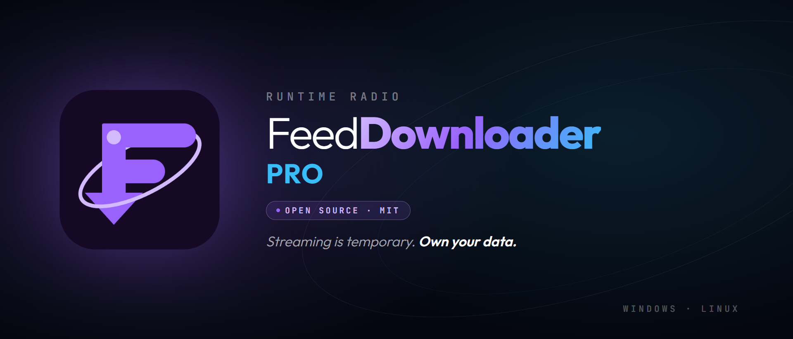

<div align="center">
  

  # Runtime FeedDownloader Pro

  **Il modo più potente per archiviare i tuoi podcast.**

  
  
  
  
  

  [](https://github.com/Pitz72/FeedDownloader/actions/workflows/build.yml)
</div>

---

## Panoramica

**Runtime FeedDownloader Pro** è un'applicazione desktop per l'archiviazione massiva di podcast RSS. Scarica, organizza e cataloga episodi da qualsiasi feed RSS con resilienza di rete, download paralleli configurabili e un'interfaccia moderna.

Nasce nel 2026 come strumento interno di [Runtime Radio](https://runtimeradio.com) per conservare cataloghi di podcast prima che spariscano dai server di chi li pubblica. È stato distribuito come prodotto commerciale fino all'agosto 2026, quando è stato ritirato dalla vendita e aperto sotto licenza MIT.

> **Stato del progetto.** Funzionalmente completo e in produzione. La v1.6.0 ha portato un audit completo con la correzione di tutte le criticità trovate, funzioni nuove per l'archiviazione e un'interfaccia ridisegnata. Le pull request sono benvenute — vedi [CONTRIBUTING.md](CONTRIBUTING.md).

### ✨ Caratteristiche principali

**Feed e libreria**
- **Libreria** — cruscotto con tutti i feed: episodi, archiviati, da scaricare, spazio occupato, ultimo controllo (v1.6.0)
- **Nuovi episodi riconosciuti per GUID**, non per conteggio (v1.3.12)
- **Feed paginati RFC 5005** — segue i link `rel="next"` e ricompone il catalogo, fino a 20 pagine (v1.3.12)
- **Controllo automatico** ogni 6/12/24 ore, anche dall'area di notifica, con notifica di sistema cliccabile; **Controlla i feed** su richiesta (v1.4.0, v1.6.0)
- **Archivio automatico per feed** — i nuovi episodi trovati dai controlli si scaricano da soli (v1.6.0)

**Download**
- **Per periodo** — filtro Periodo sempre visibile (preset o date Dal/Al), pulsante che dice cosa scaricherà, conferma con stima dello spazio (v1.6.0)
- **Coda gestita** — da 1 a 10 trasferimenti paralleli, selezione con caselle e intervalli, vista Download dedicata (v1.6.0)
- **Pausa e Riprendi** — singolo download o intera coda: la ripresa usa HTTP Range + If-Range (v1.5.0)
- **Pausa automatica senza rete** e **coda persistente** ripresa dopo chiusura o blocco (v1.6.0)
- **Limiti** — banda complessiva condivisa e dimensione massima per file (v1.5.0, v1.6.0)
- **Trasferimenti resilienti** — timeout 30s, stall detection 60s, 5 tentativi con backoff, `Retry-After` rispettato, file `.part`

**Integrità**
- **SHA-256 su ogni file**, calcolato dopo i tag ID3, con bitrate e sample rate (v0.7.4, v1.6.0)
- **Verifica dell'archivio** Rapida o Completa, con avanzamento e stop; «Accetta come riferimento» (v1.6.0)
- **Cerca i file spostati** — ritrova per checksum i file rinominati a mano, in tutte le cartelle dell'archivio (v1.5.0, v1.6.0)
- **Ogni episodio ricorda la sua cartella**: cambiare cartella non rende «mancante» l'archivio (v1.6.0)
- **Ripristino guidato del database** dal backup automatico in caso di corruzione (v1.5.0)

**Interfaccia**
- **Design system «Runtime Violet»** (gemello di Titan Blue), contrasti verificati WCAG 2.2 AA da script (v1.6.0)
- **Impaginazione orizzontale da scrivania** — pannelli affiancati, ognuno con il suo scorrimento (v1.6.0)
- **Palette comandi (Ctrl+K)**, interfaccia dall'80 al 180%, «Riduci animazioni», contrasto elevato di Windows
- **Export M3U e CSV**, metadati `.json` accanto ai file, riduzione nell'area di notifica, changelog in-app

**Sistema**
- **Aggiornamenti col consenso** — nessun download né installazione automatici (v1.5.0)
- **Nessuna richiesta a terzi all'avvio** — caratteri inclusi, CSP senza domini esterni (v1.6.0)
- **Anti-SSRF a 5 livelli**, con ri-verifica dell'IP a ogni connessione e redirect
- **NAS/SMB** con validazione a timeout, senza bloccare l'interfaccia
- **440 test automatici** con Vitest, gate bloccante in CI, più i controlli di traduzioni e contrasto
- **Due lingue**: italiano e inglese

### 🌐 Documentazione

| Lingua | Guida in-app | Manuale completo |
|--------|--------------|------------------|
| 🇮🇹 Italiano | [README_MASTER.md](README_MASTER.md) | [docs/user/manual-it](docs/user/manual-it/) |
| 🇬🇧 English | [README_EN.md](README_EN.md) | [docs/user/en-GB](docs/user/en-GB/) |

I PDF dei manuali sono versionati qui accanto ai sorgenti Markdown — [italiano](docs/user/manual-it/Manuale_FeedDownloader_Pro_Box.pdf), [inglese](docs/user/en-GB/FeedDownloader_Pro_Manual_en-GB.pdf) — e si aprono anche dall'app.

### 📋 Changelog

La cronologia completa delle versioni si trova in [`docs/changelog/`](docs/changelog/).

## Download

| Piattaforma | Formato | Link |
|---|---|---|
| Windows 10/11 | NSIS Installer (`.exe`) | [GitHub Releases](https://github.com/Pitz72/FeedDownloader/releases) |
| Linux | AppImage / `.deb` | [GitHub Releases](https://github.com/Pitz72/FeedDownloader/releases) |

I build sono prodotti da GitHub Actions con trigger manuale (workflow dispatch).

> **macOS non è supportato** (decisione definitiva, agosto 2026): nessun build ufficiale
> viene distribuito né lo sarà. Chi vuole usare l'app su macOS può **auto-compilarla**
> dai sorgenti (`npm install && npm run build` su un Mac aggiunge da sé il target,
> ma senza firma, notarizzazione né supporto). Le piattaforme di distribuzione sono
> Windows e Linux, come per le altre app desktop Runtime (standard Titan).
>
> **Code-signing (limite noto L6):** i binari Windows/Linux non sono firmati con un
> certificato commerciale — SmartScreen può mostrare un avviso al primo avvio.
> La firma richiede un certificato OV/EV a pagamento con verifica d'identità;
> la valutazione resta aperta ma non è pianificata.

## Quick Start (sviluppo)

```bash
# Installa dipendenze
npm install

# Avvia in modalità sviluppo
npm run dev

# Anteprima dell'interfaccia nel browser, con dati finti (http://localhost:5198)
npm run preview:ui

# Controlli: test, lint, traduzioni, contrasto, tipi del banco di prova
npm test
npm run lint
npm run check:locales
npm run check:contrast
npm run check:preview

# Build locale (no publish)
npm run build

# Build + publish su GitHub Releases (richiede tag v*)
npm run release
```

## Stack Tecnologico

| Layer | Tecnologia |
|-------|-----------|
| Desktop | Electron 43 |
| UI | React 18 + TypeScript |
| Build | Vite 7 |
| Stile | Tailwind CSS v4 |
| Animazioni | Framer Motion |
| Stato | Zustand 5 |
| i18n | i18next |
| Persistenza | better-sqlite3 (SQLite) |
| Download Queue | p-queue |
| Virtualizzazione | react-virtuoso |
| Test | Vitest |

## Requisiti di Sistema

| Piattaforma | Requisito minimo |
|---|---|
| Windows | 10 / 11 (64-bit) |
| Linux | Ubuntu 20.04+, Debian 11+, Fedora 34+ (o equivalente) |
| macOS | *non supportato* — solo auto-compilazione dai sorgenti |

- **RAM:** 4 GB (raccomandato)
- **Disco:** Spazio sufficiente per gli archivi podcast

---

## Sostenere il progetto

Il programma è gratuito e lo resterà. Se ti è utile e vuoi dare una mano:

### 👉 **[simonepizzi.runtimeradio.it/contatti](https://simonepizzi.runtimeradio.it/contatti)**

Per una donazione diretta: **[paypal.me/runtimeradio](https://www.paypal.com/paypalme/runtimeradio)**

---

## Privacy

L'applicazione funziona in locale. Contatta esclusivamente i server dei feed che aggiungi tu, gli indirizzi degli allegati audio che quei feed dichiarano e GitHub per il controllo degli aggiornamenti. Nessuna telemetria, nessun analytics, nessun account. L'archivio e il database restano sul tuo disco.

---

## Come è stato scritto

Questo programma è stato scritto facendo un **uso massiccio di modelli linguistici di grandi dimensioni**: Google **Gemini**, dalla 2.5 alla 3.1, e Anthropic **Claude**, da Sonnet 4.6 a Opus 5. Gran parte del codice che leggi l'hanno prodotta loro, ed è giusto che sia dichiarato apertamente.

Tutto il resto è di **Simone Pizzi**: il concetto, la visione, la direzione progettuale, la definizione minuziosa di ogni dettaglio funzionale e la caccia ostinata ai bug. Ogni comportamento del programma — dalla ripresa dei trasferimenti con `If-Range` alla riparazione dell'archivio per checksum, dal rilevamento dei nuovi episodi via GUID al modo in cui un aggiornamento chiede il permesso prima di scaricarsi — è una decisione progettuale presa, verificata sul campo e corretta a mano fino a farla funzionare.

I modelli hanno scritto il codice. Le decisioni, dalla prima all'ultima, sono state sue.

Lo stesso vale per la documentazione: manuali, guide e note tecniche sono stati redatti con questo metodo e revisionati riga per riga contro il codice.

---

## Licenza

Rilasciato sotto licenza **MIT** — vedi [LICENSE](LICENSE).

Sviluppato da **Simone Pizzi** per **[Runtime Radio](https://runtimeradio.com)**.

Fino ad agosto 2026 il progetto è stato distribuito commercialmente. Quella fase è chiusa: il software è ora liberamente utilizzabile, modificabile e ridistribuibile secondo i termini MIT.
